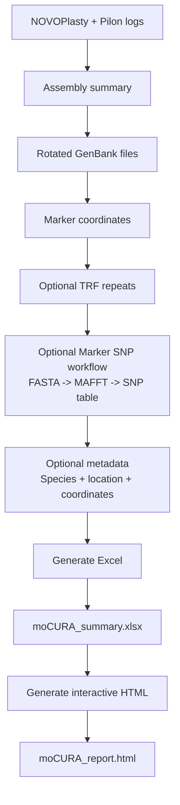

<p align="center">
  
</p>

# moCURA

**moCURA** is a Python pipeline for reading organellar assembly results, integrating NOVOPlasty, Pilon, GenBank annotations, tandem repeats, marker-level SNP comparisons and optional sampling metadata into a single Excel workbook and an interactive HTML report.

The current report is designed to support comparisons across many projects, seeds and K-mer values. Static Matplotlib/Seaborn figures can be disabled so that the interactive HTML becomes the main visualization layer.

## Contents Overview 

- [Main features](#main-features)
- [Pipelines currently supported](#pipelines-currently-supported)
- [Workflow overview](#workflow-overview)
- [Prerequisites](#prerequisites)
- [Installation](#installation)
  - [With Conda](#with-conda)
  - [With Singularity/Apptainer](#with-singularityapptainer)
- [Basic usage](#basic-usage)
- [Command-line arguments](#command-line-arguments)
- [Input results](#input-results)
- [Metadata](#metadata)
- [Configuration](#configuration)
  - [Pipeline](#pipeline)
  - [Static figures](#static-figures)
  - [GenBank loading](#genbank-loading)
  - [TRF](#trf)
  - [Marker SNP workflow](#marker-snp-workflow)
  - [HTML report](#html-report)
- [Interactive HTML report](#interactive-html-report)
- [Marker SNP analysis](#marker-snp-analysis)
- [Tandem repeats](#tandem-repeats)
- [HTML-only mode](#html-only-mode)
- [Output files](#output-files)
- [Large datasets and HPC recommendations](#large-datasets-and-hpc-recommendations)
- [Singularity/Apptainer](#singularityapptainer)
- [SLURM](#slurm)
- [Troubleshooting](#troubleshooting)
- [Development team](#development-team)

## Main features
##### [:rocket: Go to Contents Overview](#contents-overview)
moCURA currently provides:

- asynchronous parsing of NOVOPlasty and Pilon results;
- integration of assembly metrics by `Project/Species name`, `Seed Input` and `K-mer`;
- optional filtering to circularized assemblies;
- loading of rotated GenBank files and organellar marker annotations;
- an Excel summary containing assembly, marker and repeat information;
- Tandem Repeats Finder (TRF), analysis on organellar genomes;
- extraction of homologous markers from multiple projects and K-mers;
- MAFFT alignment of each marker across projects;
- true-SNP detection from marker alignments;
- an interactive D3 report with linked assembly plots, Pilon summaries, genome structure, marker-length heatmaps, tandem-repeat comparisons and SNP matrices;
- interactive reference selection for marker SNP panels;
- optional metadata integration by `Project name`;
- species names displayed in italics, with project identifiers retained in bold parentheses;
- location-aware repeat and SNP comparisons;
- an interactive Leaflet sampling map using OpenStreetMap tiles;
- an HTML-only workflow that disables unnecessary Python image generation.

## Pipelines currently supported
##### [:rocket: Go to Contents Overview](#contents-overview)
Currently, moCURA supports the following pipelines:

| Pipeline | GitHub |
|---|---|
| OrganPipe | [Repository](https://github.com/itvgenomics/organpipe) |
| SnakeSeek | [Repository](https://github.com/luanrabelo/snakeseek) |

## Workflow overview
##### [:rocket: Go to Contents Overview](#contents-overview)
A typical execution follows this sequence:



## Prerequisites
##### [:rocket: Go to Contents Overview](#contents-overview)
Before you run ***moCURA***, make sure you have the following prerequisites installed:

### Python Environment
 - Python 3.14 or higher
 - Conda package manager (Miniconda or Anaconda)
 - Singularity or Apptainer (optional, for containerized execution)

The supplied Conda environment contains the main runtime dependencies:

- `biopython=1.86`
- `mafft=7.525`
- `matplotlib=3.11.0`
- `numpy=2.5.1`
- `openpyxl=3.1.5`
- `pandas=3.0.3`
- `pip=26.1.2`
- `python=3.14`
- `pyyaml=6.0.3`
- `seaborn=0.13.2`
- `setuptools=83.0.0`
- `singularity=2.4.2`
- `syngenes=1.0.6`
- `trf=4.09.1`
- pip:
  - `snpit==1.7`

The interactive HTML report also loads browser-side libraries from the internet:

- D3.js 7.9.0, with multiple CDN fallbacks;
- Leaflet 1.9.4 from `unpkg.com`;
- OpenStreetMap map tiles from `tile.openstreetmap.org`.

Therefore, the report can be generated on an offline compute node, but D3 and the map require network access when the final HTML is opened in a browser unless those browser assets are later bundled locally.

## Installation
##### [:rocket: Go to Contents Overview](#contents-overview)
### With Conda

Create the supplied environment:

```bash
conda env create -f environment.yml
conda activate mocura_env
```

Check the main external programs:

```bash
python --version
mafft --version
trf
```

Run the command help:

```bash
python mocura.py --help
```

### With Singularity/Apptainer

Create the container image:

```bash
/usr/bin/singularity build mocura.sif mocura.def
```

Check the main external programs:

```bash
/usr/bin/singularity exec mocura.sif python --version
/usr/bin/singularity exec mocura.sif mafft --version
/usr/bin/singularity exec mocura.sif trf
```

Run the command help:

```bash
/usr/bin/singularity exec mocura.sif python mocura.py --help
```

## Basic usage
##### [:rocket: Go to Contents Overview](#contents-overview)
Minimal execution:
- With Conda:

```bash
python mocura.py \
    --results-dir absolute/path/to/results \
    --output-dir absolute/path/to/mocura_output
```

- With Singularity/Apptainer:

```bash
/usr/bin/singularity run \
    --bind absolute/path/to/results:/data/input \
    --bind absolute/path/to/output:/data/output \
    mocura.sif \
    python mocura.py \
    --results-dir /data/input \
    --output-dir /data/output
```

With an explicit configuration file:
- With Conda:

```bash
python mocura.py \
    --results-dir absolute/path/to/results \
    --output-dir absolute/path/to/mocura_output \
    --config config.yml
```

- With Singularity/Apptainer:

```bash
/usr/bin/singularity run \
    --bind absolute/path/to/results:/data/input \
    --bind absolute/path/to/output:/data/output \
    --bind absolute/path/to/config.yml:/config/config.yml \
    mocura.sif \
    python mocura.py \
    --results-dir /data/input \
    --output-dir /data/output \
    --config /config/config.yml
```

With metadata:
- With Conda:

```bash
python mocura.py \
    --results-dir /path/to/results \
    --output-dir /path/to/mocura_output \
    --config config.yml \
    --metadata metadata.xlsx
```

- With Singularity/Apptainer:

```bash
/usr/bin/singularity run \
    --bind /path/to/results:/data/input \
    --bind /path/to/output:/data/output \
    --bind /path/to/config.yml:/config/config.yml \
    --bind /path/to/metadata.xlsx:/config/metadata.xlsx \
    mocura.sif \
    python mocura.py \
    --results-dir /data/input \
    --output-dir /data/output \
    --config /config/config.yml \
    --metadata /config/metadata.xlsx
```

For a 20-CPU run restricted to circularized assemblies:
- With Conda:

```bash
python mocura.py \
    --results-dir /path/to/results \
    --output-dir /path/to/mocura_output \
    --config config.yml \
    --metadata metadata.xlsx \
    --threads 20 \
    --only-circularized
```

- With Singularity/Apptainer:

```bash
/usr/bin/singularity run \
    --bind /path/to/results:/data/input \
    --bind /path/to/output:/data/output \
    --bind /path/to/config.yml:/config/config.yml \
    --bind /path/to/metadata.xlsx:/config/metadata.xlsx \
    mocura.sif \
    python mocura.py \
    --results-dir /data/input \
    --output-dir /data/output \
    --config /config/config.yml \
    --metadata /config/metadata.xlsx \
    --threads 20 \
    --only-circularized
```

## Command-line arguments
##### [:rocket: Go to Contents Overview](#contents-overview)
| Category | Argument | Description |
|---|---|---|
| Input | `-i`, `--results-dir` | Required. Directory containing the organellar assembly results. |
| Input | `-c`, `--config` | YAML configuration file. When omitted, the `config.yml` distributed with moCURA is used. |
| Input | `--metadata` | Optional CSV, TSV, XLSX or ODS table mapped to the report by `Project name`. |
| Output | `-o`, `--output-dir` | Required. Destination directory for the Excel workbook, HTML report, TRF results, marker alignments and SNP tables. |
| Threading | `-t`, `--threads` | Overrides `pipeline.threads` from `config.yml` for general concurrent work such as asynchronous file processing. Important: MAFFT has its own independent concurrency and thread settings under `marker_snp_analysis.mafft`. Increasing `--threads` does not automatically increase MAFFT concurrency. |
| Other | `--only-circularized` | Process only circularized assemblies. |
| Other | `--no-only-circularized` | Allow circularized and non-circularized assemblies. |
| Other | `--fig-format` | Overrides the static figure format configured in `figures.format`. |
| Other | `--dpi` | Overrides `figures.dpi`. |

## Input results
##### [:rocket: Go to Contents Overview](#contents-overview)

moCURA reads data from an existing organellar assembly workflow rather than assembling raw reads itself.

The loaders search the results directory for NOVOPlasty and Pilon records and merge them using:

```text
Project name
Seed Input
K-mer
```

Rotated annotated genomes are loaded from the GenBank folder configured under:

```yaml
genbank:
  folder_name: genbanks
  suffix: .rotated.gb
```

The default feature classes loaded from these GenBank files are:

```yaml
feature_types:
  - CDS
  - rRNA
  - tRNA
  - D-loop
  - misc_feature
  - regulatory
```

These records are used by the genome-structure visualization, marker-length comparison, TRF genomic context annotation and marker SNP workflow.

## Metadata
##### [:rocket: Go to Contents Overview](#contents-overview)
Metadata are optional. When supplied, they are joined by `Project name`. See in example folder `metadata.xlsx` for a sample table.

Recommended columns:

| Column | Description |
|---|---|
| `Project name` | Identifier matching the assembly project exactly |
| `Species` | Scientific name displayed in the report |
| `Location` | Sampling locality |
| `Latitude` | Latitude in decimal degrees or DMS |
| `Longitude` | Longitude in decimal degrees or DMS |

Example:

```text
Project name    Species                   Location    Latitude        Longitude
ITV42553        Kinosternon leucostomum   Jacaré      6°21'23.43"S   50°23'34.39"O
```

Decimal coordinates are also accepted:

```text
-6.356508, -50.392886
```

The coordinate parser accepts south and west coordinates as negative values and also recognizes `O` as Oeste in DMS longitude strings.

### Metadata discovery

Metadata can be supplied explicitly:

```bash
--metadata absolute/path/to/metadata.xlsx
```

or configured under:

```yaml
html_report:
  metadata_path: absolute/path/to/metadata.xlsx
```

If neither is specified, moCURA looks in the configuration-file directory for:

```text
metadata.xlsx
metadata.ods
metadata.tsv
metadata.csv
```

### Species labels

When metadata are available, the report displays the first two terms of the scientific name and preserves the project identifier, for example:

```text
Kinosternon leucostomum (ITV42553)
```

The species is rendered in italics and the project identifier in bold. The interactive report includes an `Abbreviate species` option that converts the display to:

```text
K. leucostomum (ITV42553)
```

The abbreviation is disabled by default.

## Configuration
##### [:rocket: Go to Contents Overview](#contents-overview)
The main configuration file is `config.yml`.

### Pipeline

```yaml
pipeline:
  threads: 20
  only_circularized: true
```

`threads` controls general concurrency. `only_circularized` determines the default assembly filter.

### Static figures

```yaml
figures:
  format: png
  dpi: 300
```

Individual static plots are controlled under `plots:`.

### GenBank loading

```yaml
genbank:
  enabled: true
  folder_name: genbanks
  suffix: .rotated.gb
  include_unknown_markers: false
```

### TRF

The current defaults are:

```yaml
trf:
  enabled: true
  output_folder: trf_analysis
  binary: trf
  overwrite: false
  concurrency: 12
  timeout: 3600
  match: 2
  mismatch: 7
  delta: 7
  match_probability: 80
  indel_probability: 10
  min_score: 50
  max_period: 500
```

### Marker SNP workflow

The marker SNP section controls extraction, MAFFT and SNP rendering.

A conservative HPC-oriented MAFFT configuration is:

```yaml
marker_snp_analysis:
  enabled: true
  minimum_sequences: 2
  minimum_projects: 2
  mafft:
    binary: mafft
    mode: fftns2
    concurrency: 2
    threads_per_job: 4
```

The report can render SNPs directly from the TSV matrix, so PNG generation can remain disabled:

```yaml
snp_matrix:
  save_table: true
  save_image: false
```

### HTML report

```yaml
html_report:
  enabled: true
  output_file: moCURA_report.html
  title: moCURA interactive report
  snp_columns_per_panel: 60
  snp_project_gap: 12
  snp_compact_max_columns: 14
  pilon_stack_threshold: 10
  pilon_height_per_group: 22
  pilon_max_height: 900
  logo_path: assets/mocura_logo.svg
  logo_alt: moCURA logo
  metadata_path: null
```

## Interactive HTML report
##### [:rocket: Go to Contents Overview](#contents-overview)
The report is divided into the following main sections.

### Project selection

At the top of the report, project buttons support multi-project comparison.

`All data` activates all projects. Individual project buttons can then be selected for a subset comparison.

### Global filters

The sticky filter bar contains:

- Seed Input
- K-mer
- Assembly status
- Tandem repeats
- Reset filters

Each multi-select supports search and checkbox selection.

### Overview

The overview includes summary cards and four linked NOVOPlasty metrics:

- Total contigs
- Largest contig
- Smallest contig
- Average organelle coverage

Species/project names are kept in a dedicated first column so the four metric plots use the full width of their own cards.

Hovering over a run fades unrelated points. Clicking a point isolates the same project, seed and K-mer combination across all four metrics; clicking it again restores the complete view.

### Assembly data

The Assembly table includes project/species, location, Seed Input, K-mer, circularization and assembly/Pilon metrics.

Features include:

- fixed `Project / Species` and `Location` columns;
- resizable columns by dragging the header border;
- horizontal scrolling;
- right-mouse-button drag scrolling;
- search across project, species, seed, K-mer and table values;
- in-cell proportional bars for selected numerical variables.

### Pilon polishing

The interactive Pilon section contains:

- Pilon metrics heatmap;
- genome length before and after Pilon;
- Pilon SNP/insertion/deletion corrections.

For large filtered datasets, the two primary Pilon cards automatically switch from a two-column layout to a vertical one-column layout. Chart height also increases with the number of displayed groups.

This avoids compressing dozens of projects into very small side-by-side panels.

### Genome structure and tandem-repeat positions

Assemblies are grouped by identical Seed Input and K-mer combinations.

Within a group, projects share a common coordinate scale so differences in marker structure and tandem repeats can be compared directly.

The left information area identifies the project/species and locality and summarizes repeats. Repeat tooltips include:

- genomic coordinates;
- Repeat length;
- Consensus size;
- Copy number;
- genomic context.

### Marker length heatmap

The marker heatmap has three mutually exclusive classes:

- PCGs, selected by default;
- tRNAs;
- rRNAs.

Choosing one class automatically deselects the previous class.

Each marker column is normalized independently from its own minimum to maximum. This is intentional: a difference of only a few base pairs within one gene can therefore use the complete color scale instead of being hidden by the absolute size differences among genes.

The absolute marker length is printed inside every heatmap cell.

The PCG classifier recognizes common mitochondrial gene aliases such as ATP6, ATP8, COI/COII/COIII, COX1/COX2/COX3, CYTB/COB and ND/NAD genes. rRNA and tRNA names are classified separately.

### Tandem repeats

The comparative repeat table is synchronized with the global project, seed, K-mer, assembly-status and repeat filters.

Its fixed leading columns are:

```text
Project / Species
Location
```

The main repeat metrics include:

```text
Repeat length
Period Size
Copy Number
Consensus Size
Percent Matches
Percent Indels
Gene context
Consensus
```

Numerical repeat metrics use proportional in-cell bars to simplify comparison among projects and locations.

### Marker SNPs
##### [:rocket: Go to Contents Overview](#contents-overview)

Each marker with true SNPs receives an interactive D3 card.

Features include:

- actual nucleotide state for every sequence at every true-SNP column;
- explicit gaps;
- grouping by project;
- species and locality labels from metadata;
- selectable reference sequence for each marker;
- coordinates recalculated from the selected reference;
- a full-width marker-span bar;
- Manhattan-style connectors from SNP columns to their positions on the marker;
- marker start, end and total length.

When an alignment column occurs before the first nucleotide of the selected reference, it is displayed as `before position 1` instead of an artificial expression such as `ins.513@start`.

Reference selection affects both SNP coordinate labels and the SNP summary used by the sampling map.

### Sampling map

The sampling map is positioned next to the SNP workflow and is implemented with **Leaflet 1.9.4**.

It loads OpenStreetMap tiles and uses Leaflet canvas rendering for the locality circles, which is preferable when many points are present.

Interactions include:

- drag to pan;
- mouse-wheel zoom;
- standard `+` and `−` Leaflet zoom controls;
- click a locality for a popup;
- hover for a compact tooltip;
- automatic fitting to all currently filtered sampling localities.

Point size and color summarize SNP differences for the currently filtered projects and selected marker references.

If several projects have the same location and coordinates, they are grouped into a single locality point.

The map requires access to both `unpkg.com` for Leaflet and `tile.openstreetmap.org` for map tiles when the HTML file is opened.

## Marker SNP analysis

The SNP workflow uses all eligible K-mers for a marker in the same marker-level alignment.

Conceptually:

```text
rotated GenBank markers
        │
        └─> marker FASTA files
                 │
                 └─> MAFFT alignment
                          │
                          └─> true SNP detection
                                  │
                                  ├─> TSV matrix
                                  └─> optional PNG
```

The alignment directory is organized under:

```text
marker_snp_analysis/alignments/<marker>/
```

and MAFFT logs under:

```text
marker_snp_analysis/logs/mafft/
```

The configured SNP-matrix directory is normally:

```text
marker_snp_analysis/snp_matrices/
```

### Reference selection

The YAML configuration can still define an initial preferred reference, but the HTML report allows the reference to be changed interactively for each marker.

This is useful for checking whether apparent SNP coordinates depend on a particular assembly or on leading/trailing gaps in one reference sequence.

## Tandem repeats
##### [:rocket: Go to Contents Overview](#contents-overview)

TRF is run on rotated genome FASTAs derived from the loaded GenBank assemblies.

The TRF workflow creates:

```text
trf_analysis/trf_summary.tsv
trf_analysis/trf_repeats.tsv
trf_analysis/trf_consensus.fasta
```

The interactive report adds marker/gene context to repeat records when annotation coordinates are available.

## HTML-only mode
##### [:rocket: Go to Contents Overview](#contents-overview)

For large analyses, static Python figures are often unnecessary because the HTML report recreates the principal visual summaries with D3.

The supplied configuration already disables the main static plots:

```yaml
plots:
  novoplasty_summary:
    enabled: false
  genome_size_heatmap:
    enabled: false
  pilon_heatmap:
    enabled: false
  pilon_before_after_heatmap:
    enabled: false
  marker_length_heatmaps:
    enabled: false
```

For SNPs:

```yaml
marker_snp_analysis:
  snp_matrix:
    save_table: true
    save_image: false
```

This keeps the SNP TSV required by the D3 report and skips the static SNP PNG.

The following analyses still run:

```text
NOVOPlasty/Pilon parsing
GenBank parsing
Excel generation
TRF
marker extraction
MAFFT
true-SNP detection
SNP TSV generation
metadata integration
interactive HTML generation
```

## Output files
##### [:rocket: Go to Contents Overview](#contents-overview)
The exact output set depends on the enabled configuration sections. A typical HTML-only execution contains:

```text
mocura_output/
├── moCURA_summary.xlsx
├── moCURA_report.html
├── trf_analysis/
│   ├── trf_summary.tsv
│   ├── trf_repeats.tsv
│   ├── trf_consensus.fasta
│   └── ...
└── marker_snp_analysis/
    ├── alignments/
    │   └── <marker>/
    │       └── <marker>_all_kmers.aligned.fasta
    ├── logs/
    │   └── mafft/
    └── snp_matrices/
        └── ...
```

Static figure folders appear only when their respective `plots.*.enabled` setting is true.

## Large datasets and HPC recommendations
##### [:rocket: Go to Contents Overview](#contents-overview)

Large multi-project datasets require more attention to memory than CPU count alone.

### MAFFT

MAFFT concurrency can multiply memory usage because each alignment is a separate process. For a 20-CPU allocation, the following is deliberately conservative:

```yaml
mafft:
  mode: fftns2
  concurrency: 2
  threads_per_job: 4
```

This uses at most two marker alignments concurrently, each using four MAFFT threads.

For a particularly large dataset, reduce `concurrency` to `1` before increasing it.

### Static images

Keep Python plot generation disabled unless publication-ready static images are specifically needed. This reduces both runtime and memory consumption.

### HTML report layout

The HTML report contains several safeguards for larger comparisons:

- project buttons wrap instead of requiring a horizontal scrollbar;
- the Assembly overview separates species labels from metric cards;
- Assembly and repeat tables use horizontal scrolling with fixed identifying columns;
- table columns can be resized interactively;
- Marker SNP cards only scroll when the number of SNP columns requires it;
- Marker length categories can be viewed separately as PCGs, tRNAs or rRNAs;
- Pilon cards stack vertically when many groups are shown;
- chart height grows for larger Pilon comparisons;
- Leaflet uses a canvas renderer for locality circles.

### Memory diagnostics under SLURM

If a job is killed by the scheduler, inspect accounting information such as:

```bash
sacct -j JOB_ID --format=JobID,JobName%20,State,Elapsed,AllocCPUS,ReqMem,MaxRSS,MaxVMSize,ExitCode
```

An `OUT_OF_MEMORY` or `oom_kill` message indicates that the cgroup memory allocation was exceeded.

When several MAFFT processes run concurrently, total memory can exceed the job allocation even if no single process appears to use all requested memory.

## Singularity/Apptainer

The project includes `mocura.def`.

Build from the project root because `%files` uses relative project paths:

```bash
sudo /usr/bin/singularity build mocura.sif mocura.def
```

or:

```bash
/usr/bin/apptainer build --fakeroot mocura.sif mocura.def
```

Test the image:

```bash
/usr/bin/singularity test mocura.sif
```

Check the environment tools:

```bash
/usr/bin/singularity exec mocura.sif which python
/usr/bin/singularity exec mocura.sif python --version
/usr/bin/singularity exec mocura.sif which mafft
/usr/bin/singularity exec mocura.sif which trf
```

### Container execution

Without metadata:

```bash
singularity run \
    --bind /host/results:/data/input \
    --bind /host/output:/data/output \
    --bind /host/config.yml:/config/config.yml \
    mocura.sif \
    --results-dir /data/input \
    --output-dir /data/output \
    --config /config/config.yml \
    --only-circularized
```

With metadata:

```bash
singularity run \
    --bind /host/results:/data/input \
    --bind /host/output:/data/output \
    --bind /host/config.yml:/config/config.yml \
    --bind /host/metadata.xlsx:/config/metadata.xlsx \
    mocura.sif \
    --results-dir /data/input \
    --output-dir /data/output \
    --config /config/config.yml \
    --metadata /config/metadata.xlsx \
    --threads 20 \
    --only-circularized
```

## SLURM

A template is provided in `run_mocura.slurm`.

Example resource block:

```bash
#SBATCH --job-name=moCURA
#SBATCH --output=moCURA_%j.out
#SBATCH --error=moCURA_%j.err
#SBATCH --partition=op1_slurm
#SBATCH --nodes=1
#SBATCH --mem=96G
#SBATCH --cpus-per-task=20
#SBATCH --time=12:00:00
#SBATCH --mail-type=BEGIN,END,FAIL
#SBATCH --mail-user=<your-email@example.com>
```

The memory value should be adapted to the number and size of marker alignments. Increasing MAFFT concurrency without increasing RAM can cause OOM termination.

A metadata-aware Singularity command can use variables such as:

```bash
SIF=/absolute/path/to/mocura.sif
RESULTS=/absolute/path/to/results
OUTPUT=/absolute/path/to/mocura_output
CONFIG=/absolute/path/to/config.yml
METADATA=/absolute/path/to/metadata.xlsx
THREADS=16

cd $SLURM_SUBMIT_DIR

mkdir -p \
$SLURM_SUBMIT_DIR/singularity \
$SLURM_SUBMIT_DIR/tmp
```

and bind them into `/data/input`, `/data/output`, `/config`, and `/config/metadata.xlsx` (optional). See the `run_mocura.slurm` template for a complete example.

```bash
singularity exec \
    --bind "${RESULTS}:/data/input" \
    --bind "${OUTPUT}:/data/output" \
    --bind "${CONFIG}:/config/config.yml" \
    --bind "${METADATA}:/config/metadata.xlsx" \
    "${SIF}" \
    python /opt/mocura/mocura.py \
    --results-dir /data/input \
    --output-dir /data/output \
    --config /config/config.yml \
    --metadata /config/metadata.xlsx \
    --threads "${THREADS}" \
    --only-circularized
```

## Troubleshooting

### `moCURA report could not initialize`

The error box normally includes the JavaScript exception. Confirm that the report was regenerated with the latest `generate_html_report.py` and that D3 can be downloaded by the browser.

### D3 cannot load

The interactive report requires network access to a D3 CDN. Check browser/network restrictions when opening the generated HTML.

### `Unknown image format/type: mocura.sif`

This happens when `mocura.sif` is a wrapper executable rather than a plain SIF image.

Check the file type:

```bash
file mocura.sif
```

If it shows `run-singularity script executable`, use:

```bash
/usr/bin/singularity exec /absolute/path/to/mocura.sif python mocura.py --help
```

If you need `singularity exec mocura.sif ...`, rebuild the image to a plain SIF:

```bash
/usr/bin/singularity build --force mocura.sif mocura.def
```

### Leaflet map is blank

Check all of the following:

1. the metadata table was actually loaded;
2. `Project name` values match the assembly projects;
3. latitude and longitude are valid;
4. the browser can access `https://unpkg.com`;
5. the browser can access `https://tile.openstreetmap.org`.

The map status line reports whether Leaflet itself failed or individual map tiles could not be loaded.

### The map has no points

A point is only shown if its project passes the current project/filter selection and valid coordinates are available.

### MAFFT job is OOM-killed

Reduce:

```yaml
marker_snp_analysis:
  mafft:
    concurrency: 1
```

or increase the SLURM memory allocation if the cluster permits it.

### SNP analysis is skipped

With the default:

```yaml
marker_snp_analysis:
  only_when_circularized: true
```

marker SNP analysis requires the pipeline to be running in circularized-only mode.

### Partial/old outputs after a failed run

The SNP workflow has an `overwrite` setting. If a run was terminated while an alignment was being written, inspect the marker alignment and log before reusing it. Deleting the affected incomplete alignment before rerunning is safer than treating a partial file as valid.


## Development team

**Luan Rabelo and Renato Moreira-Oliveira**  
Instituto Tecnológico Vale
The project is part of the Brazilian Biodiversity Genomics Consortium, GBB.
