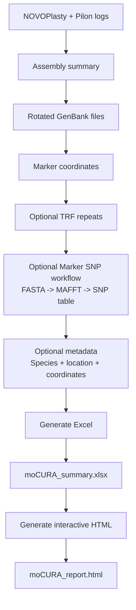

<p align="center">
  
</p>

# moCURA

**moCURA** is a Python pipeline for reading organellar assembly results, integrating NOVOPlasty, Pilon, GenBank annotations, tandem repeats, marker-level SNP comparisons and optional sampling metadata into a single Excel workbook and an interactive HTML report.

The current report is designed to support comparisons across many projects, seeds and K-mer values. Static Matplotlib/Seaborn figures can be disabled so that the interactive HTML becomes the main visualization layer.

## Contents Overview 

- [Main features](#main-features)
- [Pipelines currently supported](#pipelines-currently-supported)
- [Workflow overview](#workflow-overview)
- [Prerequisites](#prerequisites)
- [Installation](#installation)
  - [With Conda](#with-conda)
  - [With Singularity/Apptainer](#with-singularityapptainer)
- [Basic usage](#basic-usage)
- [Command-line arguments](#command-line-arguments)
- [Input results](#input-results)
- [Metadata](#metadata)
- [Configuration](#configuration)
  - [Pipeline](#pipeline)
  - [Static figures](#static-figures)
  - [GenBank loading](#genbank-loading)
  - [TRF](#trf)
  - [Marker SNP workflow](#marker-snp-workflow)
  - [HTML report](#html-report)
  - [OrganPipe quality analyses](#organpipe-quality-analyses)
- [Interactive HTML report](#interactive-html-report)
- [Marker SNP analysis](#marker-snp-analysis)
- [Tandem repeats](#tandem-repeats)
- [HTML-only mode](#html-only-mode)
- [Output files](#output-files)
- [Large datasets and HPC recommendations](#large-datasets-and-hpc-recommendations)
- [Singularity/Apptainer](#singularityapptainer)
  - [Testing the image with the example dataset](#testing-the-image-with-the-example-dataset)
- [Interactive input guide](#interactive-input-guide)
- [SLURM](#slurm)
- [Troubleshooting](#troubleshooting)
- [Future work](#future-work)
- [Development team](#development-team)

## Main features
##### [:rocket: Go to Contents Overview](#contents-overview)
moCURA currently provides:

- asynchronous parsing of NOVOPlasty and Pilon results;
- integration of assembly metrics by `Project/Species name`, `Seed Input` and `K-mer`;
- optional filtering to circularized assemblies;
- loading of rotated GenBank files and organellar marker annotations;
- an Excel summary containing assembly, marker and repeat information;
- Tandem Repeats Finder (TRF), analysis on organellar genomes;
- extraction of homologous markers from multiple projects and K-mers;
- MAFFT alignment of each marker across projects;
- true-SNP detection from marker alignments;
- an interactive D3 report with linked assembly plots, Pilon summaries, genome structure, marker-length heatmaps, tandem-repeat comparisons and SNP matrices;
- interactive reference selection for marker SNP panels;
- optional metadata integration by `Project name`;
- species names displayed in italics, with project identifiers retained in bold parentheses;
- location-aware repeat and SNP comparisons;
- an interactive Leaflet sampling map using OpenStreetMap tiles;
- an HTML-only workflow that disables unnecessary Python image generation.

## Pipelines currently supported
##### [:rocket: Go to Contents Overview](#contents-overview)
Currently, moCURA supports the following pipelines:

| Pipeline | GitHub |
|---|---|
| OrganPipe | [Repository](https://github.com/itvgenomics/organpipe) |
| SnakeSeek | [Repository](https://github.com/luanrabelo/snakeseek) |

## Workflow overview
##### [:rocket: Go to Contents Overview](#contents-overview)
A typical execution follows this sequence:



## Prerequisites
##### [:rocket: Go to Contents Overview](#contents-overview)
Before you run ***moCURA***, make sure you have the following prerequisites installed:

### Python Environment
 - Python 3.14 or higher
 - Conda package manager (Miniconda or Anaconda)
 - Singularity or Apptainer (optional, for containerized execution)

The supplied Conda environment contains the main runtime dependencies:

- `biopython=1.86`
- `mafft=7.525`
- `matplotlib=3.11.0`
- `numpy=2.5.1`
- `openpyxl=3.1.5`
- `pandas=3.0.3`
- `pip=26.1.2`
- `pysam=0.24.1` (reads the rotated BAMs for the junction check)
- `pytest=9.2.0`
- `python=3.14`
- `pyyaml=6.0.3`
- `seaborn=0.13.2`
- `setuptools=83.0.0`
- `singularity=2.4.2`
- `syngenes=1.0.6`
- `trf=4.09.1`
- pip:
  - `snpit==1.7`

The interactive HTML report also loads browser-side libraries from the internet:

- D3.js 7.9.0, with multiple CDN fallbacks;
- Leaflet 1.9.4 from `unpkg.com`;
- OpenStreetMap map tiles from `tile.openstreetmap.org`.

Therefore, the report can be generated on an offline compute node, but D3 and the map require network access when the final HTML is opened in a browser unless those browser assets are later bundled locally.

## Installation
##### [:rocket: Go to Contents Overview](#contents-overview)
### With Conda

Create the supplied environment:

```bash
conda env create -f environment.yml
conda activate mocura_env
```

Check the main external programs:

```bash
python --version
mafft --version
trf
```

Run the command help:

```bash
python mocura.py --help
```

### With Singularity/Apptainer

Create the container image:

```bash
/usr/bin/singularity build mocura.sif mocura.def
```

Check the main external programs:

```bash
/usr/bin/singularity exec mocura.sif python --version
/usr/bin/singularity exec mocura.sif mafft --version
/usr/bin/singularity exec mocura.sif trf
```

Run the command help:

```bash
/usr/bin/singularity exec mocura.sif python mocura.py --help
```

## Basic usage
##### [:rocket: Go to Contents Overview](#contents-overview)
Minimal execution:
- With Conda:

```bash
python mocura.py \
    --results-dir absolute/path/to/results \
    --output-dir absolute/path/to/mocura_output
```

- With Singularity/Apptainer:

```bash
/usr/bin/singularity run \
    --bind absolute/path/to/results:/data/input \
    --bind absolute/path/to/output:/data/output \
    mocura.sif \
    python mocura.py \
    --results-dir /data/input \
    --output-dir /data/output
```

With an explicit configuration file:
- With Conda:

```bash
python mocura.py \
    --results-dir absolute/path/to/results \
    --output-dir absolute/path/to/mocura_output \
    --config config.yml
```

- With Singularity/Apptainer:

```bash
/usr/bin/singularity run \
    --bind absolute/path/to/results:/data/input \
    --bind absolute/path/to/output:/data/output \
    --bind absolute/path/to/config.yml:/config/config.yml \
    mocura.sif \
    python mocura.py \
    --results-dir /data/input \
    --output-dir /data/output \
    --config /config/config.yml
```

With metadata:
- With Conda:

```bash
python mocura.py \
    --results-dir /path/to/results \
    --output-dir /path/to/mocura_output \
    --config config.yml \
    --metadata metadata.xlsx
```

- With Singularity/Apptainer:

```bash
/usr/bin/singularity run \
    --bind /path/to/results:/data/input \
    --bind /path/to/output:/data/output \
    --bind /path/to/config.yml:/config/config.yml \
    --bind /path/to/metadata.xlsx:/config/metadata.xlsx \
    mocura.sif \
    python mocura.py \
    --results-dir /data/input \
    --output-dir /data/output \
    --config /config/config.yml \
    --metadata /config/metadata.xlsx
```

For a 20-CPU run restricted to circularized assemblies:
- With Conda:

```bash
python mocura.py \
    --results-dir /path/to/results \
    --output-dir /path/to/mocura_output \
    --config config.yml \
    --metadata metadata.xlsx \
    --threads 20 \
    --only-circularized
```

- With Singularity/Apptainer:

```bash
/usr/bin/singularity run \
    --bind /path/to/results:/data/input \
    --bind /path/to/output:/data/output \
    --bind /path/to/config.yml:/config/config.yml \
    --bind /path/to/metadata.xlsx:/config/metadata.xlsx \
    mocura.sif \
    python mocura.py \
    --results-dir /data/input \
    --output-dir /data/output \
    --config /config/config.yml \
    --metadata /config/metadata.xlsx \
    --threads 20 \
    --only-circularized
```

## Command-line arguments
##### [:rocket: Go to Contents Overview](#contents-overview)
| Category | Argument | Description |
|---|---|---|
| Input | `-i`, `--results-dir` | Required. Directory containing the organellar assembly results. |
| Input | `-c`, `--config` | YAML configuration file. When omitted, the `config.yml` distributed with moCURA is used. |
| Input | `--metadata` | Optional CSV, TSV, XLSX or ODS table mapped to the report by `Project name`. |
| Input | `--organpipe-dir` | Optional root of the OrganPipe run (the folder that holds `results/`, `workflow/reports/` and `benchmarks/`). Used for fastp reports and Snakemake benchmarks. When omitted, moCURA uses `organpipe.organpipe_dir` from `config.yml`, or the parent of `--results-dir` when those folders are siblings of it. |
| Output | `-o`, `--output-dir` | Required. Destination directory for the Excel workbook, HTML report, TRF results, marker alignments and SNP tables. |
| Threading | `-t`, `--threads` | Overrides `pipeline.threads` from `config.yml` for general concurrent work such as asynchronous file processing. Important: MAFFT has its own independent concurrency and thread settings under `marker_snp_analysis.mafft`. Increasing `--threads` does not automatically increase MAFFT concurrency. |
| Other | `--only-circularized` | Process only circularized assemblies. |
| Other | `--no-only-circularized` | Allow circularized and non-circularized assemblies. |
| Other | `--fig-format` | Overrides the static figure format configured in `figures.format`. |
| Other | `--dpi` | Overrides `figures.dpi`. |

## Input results
##### [:rocket: Go to Contents Overview](#contents-overview)

moCURA reads data from an existing organellar assembly workflow rather than assembling raw reads itself.

The loaders search the results directory for NOVOPlasty and Pilon records and merge them using:

```text
Project name
Seed Input
K-mer
```

Rotated annotated genomes are loaded from the GenBank folder configured under:

```yaml
genbank:
  folder_name: genbanks
  suffix: .rotated.gb
```

The default feature classes loaded from these GenBank files are:

```yaml
feature_types:
  - CDS
  - rRNA
  - tRNA
  - D-loop
  - misc_feature
  - regulatory
```

These records are used by the genome-structure visualization, marker-length comparison, TRF genomic context annotation and marker SNP workflow.

### Directory layouts

Older OrganPipe runs write `results/{sample}/{step}/...`; current runs add an assembler level, `results/{sample}/{step}/novoplasty/...`. moCURA accepts both for every step (`pilon`, `genbanks`, `mitos2`, `images`, `nhmmer`).

### OrganPipe files read by the quality analyses

`{asm}` is the assembly header, for example `CA_1_ITV38325_1-NADH_dehydrogenase_subunit_1_20_1`, and `{seed}_kmer{k}` the seed folder, for example `1-NADH_dehydrogenase_subunit_1_kmer20`.

| File | Used for | Coordinates |
| --- | --- | --- |
| `mitos2/{seed}_kmer{k}/{asm}/result.mitos`, `result.geneorder` | 37-gene completeness and gene order | after Pilon |
| `mitos2/{seed}_kmer{k}/{asm}/ignored.mitos` | genes kept only as a fragment because they cross the contig origin (the 12S problem) | after Pilon |
| `images/{seed}_kmer{k}/{asm}.rotated.depth` (fallback `{asm}.depth`) | coverage profile | rotated (fallback: before Pilon) |
| `images/{seed}_kmer{k}/{asm}.rotated.blastn.out` (fallback `{asm}.blastn.out`) | read recruitment | rotated (fallback: after Pilon) |
| `images/{seed}_kmer{k}/{asm}*.png` | linked as OrganPipe plots in the coverage and recruitment tables | |
| `pilon/{asm}/{asm}.changes`, `pilon/{asm}/pilon.log` | Pilon change positions and unresolved `NoSolution` breaks | moved to rotated |
| `genbanks/{asm}.gb` | rotation offset (start of `rrnS`) and assemblies that were never rotated | after Pilon |
| `nhmmer/{seed}_kmer{k}/{asm}/intergenes_filter.tblout.out` | tRNA, rRNA and origin hits outside annotated features | after Pilon |
| `{organpipe_dir}/resources/{sample}/rawreads/fastp.json` | read QC per sample | |
| `{organpipe_dir}/benchmarks/{sample}/**` | Snakemake wall time, CPU time and memory per rule | |
| `images/{seed}_kmer{k}/{asm}.rotated_mapping.bam` | reads crossing the circularization junction (pysam) | rotated |
| `genbanks/{asm}.rotated.gb` (fallback `{asm}.gb`) | annotation integrity, concordance alignment, composition and RSCU | rotated (fallback: after Pilon) |
| `{organpipe_dir}/config/config.yaml` | `genetic_code` for translation, when `annotation_integrity.genetic_code` is null | |

Positions are moved to the rotated genome with the rotation offset: `rotated = ((after_Pilon − 1 − offset) mod length) + 1`. Positions before Pilon are first shifted by the indels listed in `.changes`.

Every file is optional. A missing file logs one summary warning per analysis and leaves the values empty; the run continues. With no OrganPipe quality files, the existing sheets and report sections are unchanged.

**Limitation.** The OrganPipe BAM, depth and BLAST files are built from NOVOPlasty's own `Assembled_reads`. Coverage, read recruitment and junction support computed from them tend to agree with the assembly by construction: they flag problems but do not validate it independently. `junction_validation.bam_template` already accepts another BAM (for example raw reads mapped on the rotated genome); producing that mapping is not part of moCURA.

## Metadata
##### [:rocket: Go to Contents Overview](#contents-overview)
Metadata are optional. When supplied, they are joined by `Project name`. See in example folder `metadata.xlsx` for a sample table.

Recommended columns:

| Column | Description |
|---|---|
| `Project name` | Identifier matching the assembly project exactly |
| `Species` | Scientific name displayed in the report |
| `Location` | Sampling locality |
| `Latitude` | Latitude in decimal degrees or DMS |
| `Longitude` | Longitude in decimal degrees or DMS |

Example:

```text
Project name    Species                   Location    Latitude        Longitude
ITV42553        Kinosternon leucostomum   Jacaré      6°21'23.43"S   50°23'34.39"O
```

Decimal coordinates are also accepted:

```text
-6.356508, -50.392886
```

The coordinate parser accepts south and west coordinates as negative values and also recognizes `O` as Oeste in DMS longitude strings.

### Metadata discovery

Metadata can be supplied explicitly:

```bash
--metadata absolute/path/to/metadata.xlsx
```

or configured under:

```yaml
html_report:
  metadata_path: absolute/path/to/metadata.xlsx
```

If neither is specified, moCURA looks in the configuration-file directory for:

```text
metadata.xlsx
metadata.ods
metadata.tsv
metadata.csv
```

### Species labels

When metadata are available, the report displays the first two terms of the scientific name and preserves the project identifier, for example:

```text
Kinosternon leucostomum (ITV42553)
```

The species is rendered in italics and the project identifier in bold. The interactive report includes an `Abbreviate species` option that converts the display to:

```text
K. leucostomum (ITV42553)
```

The abbreviation is disabled by default.

## Configuration
##### [:rocket: Go to Contents Overview](#contents-overview)
The main configuration file is `config.yml`.

### Pipeline

```yaml
pipeline:
  threads: 20
  only_circularized: true
```

`threads` controls general concurrency. `only_circularized` determines the default assembly filter.

### Static figures

```yaml
figures:
  format: png
  dpi: 300
```

Individual static plots are controlled under `plots:`.

### GenBank loading

```yaml
genbank:
  enabled: true
  folder_name: genbanks
  suffix: .rotated.gb
  include_unknown_markers: false
```

### TRF

The current defaults are:

```yaml
trf:
  enabled: true
  output_folder: trf_analysis
  binary: trf
  overwrite: false
  concurrency: 12
  timeout: 3600
  match: 2
  mismatch: 7
  delta: 7
  match_probability: 80
  indel_probability: 10
  min_score: 50
  max_period: 500
```

### Marker SNP workflow

The marker SNP section controls extraction, MAFFT and SNP rendering.

A conservative HPC-oriented MAFFT configuration is:

```yaml
marker_snp_analysis:
  enabled: true
  minimum_sequences: 2
  minimum_projects: 2
  mafft:
    binary: mafft
    mode: fftns2
    concurrency: 2
    threads_per_job: 4
```

The report can render SNPs directly from the TSV matrix, so PNG generation can remain disabled:

```yaml
snp_matrix:
  save_table: true
  save_image: false
```

### HTML report

```yaml
html_report:
  enabled: true
  output_file: moCURA_report.html
  title: moCURA interactive report
  snp_columns_per_panel: 60
  snp_project_gap: 12
  snp_compact_max_columns: 14
  snp_min_length_ratio: 0.9
  pilon_stack_threshold: 10
  pilon_height_per_group: 22
  pilon_max_height: 900
  logo_path: assets/mocura_logo.svg
  logo_alt: moCURA logo
  metadata_path: null
```

`snp_min_length_ratio` controls which marker sequences the Marker SNP cards flag as incomplete: a sequence shorter than this fraction of the median length of that marker is hidden by default (see [Marker SNPs](#marker-snps)).

### OrganPipe quality analyses

Each analysis has its own section and can be switched off with `enabled: false`:

```yaml
organpipe:
  organpipe_dir: null            # inferred from --results-dir when null

mitos2_completeness:
  enabled: true
  output_folder: mitos2_completeness

coverage_profile:
  enabled: true
  window_size: 50                # bp
  low_depth_threshold: 10        # x
  low_coverage_alert_percent: 5  # alert when more positions than this are below the threshold
  output_folder: coverage_profile

pilon_changes:
  enabled: true
  output_folder: pilon_changes

read_recruitment:
  enabled: true
  identity_threshold: 98         # %
  output_folder: read_recruitment

nhmmer_alerts:
  enabled: true
  max_evalue: 0.001
  output_folder: nhmmer_alerts

read_qc:
  enabled: true
  output_folder: read_qc

provenance:
  enabled: true
  output_folder: provenance

assembly_alerts:
  enabled: true
  output_folder: assembly_alerts
```

| Analysis | Excel sheet | TSV files | HTML |
| --- | --- | --- | --- |
| 37-gene completeness and gene order | `MITOS2 Completeness` | `mitos2_completeness/mitos2_completeness.tsv` | Quality: completeness heatmap |
| Genes crossing the origin | `Origin Check` | `mitos2_completeness/origin_check.tsv` | Quality: alerts |
| Coverage | `Coverage` | `coverage_profile/coverage_metrics.tsv`, `coverage_windows.tsv` | Genome: depth track under each assembly; Quality table |
| Pilon changes and breaks | `Pilon Changes`, `Pilon Breaks` | `pilon_changes/pilon_changes.tsv`, `pilon_unresolved_breaks.tsv` | Genome: change marks and hatched breaks |
| Read recruitment | `Read Recruitment` | `read_recruitment/read_recruitment.tsv`, `identity_histograms.tsv` | Quality table |
| Intergenic nhmmer hits | `nhmmer Hits` | `nhmmer_alerts/nhmmer_hits.tsv` | Quality: alerts |
| Read QC (fastp) | `Read QC` | `read_qc/read_qc.tsv` | Overview: one card per project |
| Benchmarks and provenance | `Benchmarks`, `Provenance` | `provenance/benchmarks.tsv`, `provenance.tsv` | Provenance (collapsible, end of report) |
| Assembly alerts | `Assembly Alerts` | `assembly_alerts/assembly_alerts.tsv` | Quality: alert chips |

The existing sheets (`Summary`, `GenBank Files`, `Marker Lengths`, `TRF Summary`, `TRF Repeats`) and their columns are unchanged. In particular, `Marker length`, `Start` and `End` keep the raw annotation; the origin-corrected 12S length is reported only in `Origin Check`, and the marker SNP workflow still uses the annotated sequence.

Alerts never remove an assembly. Current alert types: circularized with several contigs, annotated but not rotated (no `rrnS`), gene crosses the origin, missing genes, duplicated genes, gene order differs from the project mode (compared on the genes each assembly has), unresolved Pilon break, low coverage, unannotated intergenic nhmmer hit, junction without support, weak junction support, annotation integrity errors and outside the majority group.

### Curation analyses (Phase 2)

```yaml
junction_validation:
  enabled: true
  output_folder: junction_validation
  min_flank: 20                    # bases a read must align on each side of the junction
  min_mapping_quality: 20
  supported_min_spanning_reads: 10
  weak_min_spanning_reads: 3
  weak_min_flanking_pairs: 3
  max_insert_size: 1000            # wrap-around pairs when the junction is on the origin
  bam_template: null               # another BAM, e.g. "{results_dir}/{project}/raw/{assembly}.bam"

annotation_integrity:
  enabled: true
  output_folder: annotation_integrity
  genetic_code: null               # null: OrganPipe config/config.yaml, then 2
  length_deviation_percent: 10

assembly_concordance:
  enabled: true
  output_folder: assembly_concordance
  group_identity_threshold: 99.5   # %
  group_min_coverage: 95           # % of the longer genome compared
  max_sequences: 150
  overwrite: false
  mafft: {}                        # defaults to marker_snp_analysis.mafft

sequence_composition:
  enabled: true
  output_folder: sequence_composition

assembly_score:
  enabled: true
  output_folder: assembly_score
  length_tolerance_percent: 5
  na_value: 0.5                    # value of an NA component; null leaves it out
  weights:
    completeness: 3
    integrity: 2
    junction: 2
    coverage: 1
    pilon: 1
    concordance: 2
    length: 1
```

| Analysis | Excel sheet | TSV files | HTML |
| --- | --- | --- | --- |
| Junction support | `Junction Support` | `junction_validation/junction_support.tsv` | Quality table: Junction column; alerts |
| Annotation integrity | `Annotation Integrity`, `Integrity Issues` | `annotation_integrity/annotation_integrity_summary.tsv`, `annotation_integrity_issues.tsv` | Quality table: Integrity column; Annotation integrity table; Assembly data: `Integrity alerts` column |
| Concordance | `Concordance`, `Concordance Pairs` | `assembly_concordance/concordance_groups.tsv`, `concordance_pairs.tsv`, `alignments/` | Quality: identity matrix per project |
| Composition and codon usage | `Composition`, `RSCU` | `sequence_composition/composition.tsv`, `rscu.tsv` | Composition section |
| Score and recommendation | `Recommendation` | `assembly_score/recommendation.tsv` | Recommendation section at the top |

**Junction support.** OrganPipe rotates the polished genome so it starts at rrnS and maps the reads on the rotated sequence. The start of the polished contig (`genbanks/{asm}.gb`) is searched in the rotated genome, written twice to allow for the circle and also as its reverse complement; that position is where NOVOPlasty closed the circle. When it is an internal position, moCURA counts reads aligned across it with at least `min_flank` bases on each side, and proper pairs with one mate on each side. When NOVOPlasty already wrote the genome starting at rrnS (it does when run with a reference), the junction falls on the origin, or within `min_flank` bases of it. Then the evidence is reads that bwa-mem split between the last and the first bases (primary plus supplementary alignment), and pairs whose forward mate maps in the last `max_insert_size` bases and reverse mate in the first. The result is Supported, Weak or Unsupported. It is NA for assemblies that are not circularized or have no BAM.

**Annotation integrity.** Every gene of the rotated GenBank is checked, with each protein-coding gene translated with the genetic code:

| Check | Severity |
| --- | --- |
| Internal stop codon | error |
| CDS length not a multiple of 3 that is not an incomplete stop | error |
| Start codon outside the start codons of the code | warning |
| No stop codon | warning |
| Gene crossing the contig origin | warning |
| Length more than `length_deviation_percent` away from the mode of that gene in the project | warning |
| Incomplete stop codon (T or TA) | info: in animal mitochondria it is completed to TAA by polyadenylation |

**Concordance.** The rotated genomes of each project are aligned with MAFFT (`--adjustdirection`; identical genomes are aligned once). For each pair:
- identity: identical bases over the columns where both genomes have a base;
- coverage: those columns over the length of the longer genome;
- indel events.

Assemblies are linked when identity ≥ `group_identity_threshold` and coverage ≥ `group_min_coverage`. The connected groups are reported, and the largest is the majority group. The coverage condition keeps a partial genome, which matches perfectly over the part it has, out of the majority group.

**Composition.** Reported for each genome:
- GC %, AT skew = (A − T)/(A + T) and GC skew = (G − C)/(G + C);
- the same indices for the protein-coding genes on each strand, each read 5'→3' on its coding strand;
- RSCU of the protein-coding genes, without terminal stop codons and incomplete codons.

**Score.** Each indicator becomes a component between 0 and 1:

| Component | Value |
| --- | --- |
| Completeness | genes present / 37 |
| Integrity | 1 / (1 + errors and warnings) |
| Junction | Supported 1, Weak 0.5, Unsupported 0 |
| Coverage | (1 − min(CV, 1)) × (1 − share of bases below the depth threshold) |
| Pilon | confirmed % / 100 |
| Concordance | 1 in the majority group, 0 outside |
| Length | 1 at the modal genome length of the project, falling to 0 at `length_tolerance_percent` away |

The score is the weighted mean × 100. A component that is NA counts as `na_value` (0.5), so missing evidence does not beat a failed check. Circularization is eliminatory: only circularized assemblies can be recommended. Every assembly still gets a score and a rank; nothing is discarded.

## Interactive HTML report
##### [:rocket: Go to Contents Overview](#contents-overview)
The report is divided into the following main sections.

### Layout

The filters sit in a fixed column on the left. The section links and `Abbreviate species` stay in a slim bar at the top of the content. On narrow screens (below 1000 px) the filter column moves above the report. The four Assembly overview charts share one row, with the project names in the first one. The other charts take their own row and the full width of their card. Table search boxes span the width of their card.

### Project selection

Above the project buttons, a notice shows how many projects are in view. Clicking it opens a project picker with search, `Select all`, `Select matches` (everything the search finds) and `Clear`; the choice is applied with `Show selected projects`. This is the practical way to pick a subset when a run has many projects.

`All data` activates all projects. Individual project buttons can then be selected for a subset comparison. With many projects the button area scrolls instead of growing.

### Global filters

The filter column contains:

- Seed Input
- K-mer
- Assembly status
- Tandem repeats
- Reset filters

Each multi-select supports search and checkbox selection.

### Overview

The overview includes summary cards and four linked NOVOPlasty metrics:

- Total contigs
- Largest contig
- Smallest contig
- Average organelle coverage

The four charts sit side by side in one row, always in four columns, sharing the same project rows. The project/species names appear once, on the left of the first chart.

Hovering over a run fades unrelated points. Clicking a point isolates the same project, seed and K-mer combination across all four metrics; clicking it again restores the complete view.

### Assembly data

The Assembly table includes project/species, location, Seed Input, K-mer, circularization and assembly/Pilon metrics.

Features include:

- fixed `Project / Species` and `Location` columns;
- resizable columns by dragging the header border;
- horizontal scrolling;
- right-mouse-button drag scrolling, horizontal and vertical (every table of the report);
- search across project, species, seed, K-mer and table values;
- in-cell proportional bars for selected numerical variables.

### Pilon polishing

The interactive Pilon section contains:

- Pilon metrics heatmap;
- genome length before and after Pilon;
- Pilon SNP/insertion/deletion corrections.

The cards are stacked one per row.
- **Pilon metrics** has one row per project (per seed when a single project is selected) and one column per metric, so long species names stay horizontal and the chart grows with the number of projects. Each column has its own unit (coverage in ×, confirmed bases in %, corrections as counts) and its own colour scale from its minimum to its maximum, written under the column title; a column with the same value in every row is grey. `Show values in the cells` writes the medians inside the heatmap. It is off by default, because with many rows the numbers become unreadable.
- **Bar charts** reserve room for the full project names, and their tooltips give genome lengths in whole base pairs.

### Tooltips and tables

Every tooltip uses [Tippy.js](https://atomiks.github.io/tippyjs/) 6.3.7 (with Popper 2.11.8, loaded from cdnjs or unpkg): black, with justified text. The info icons are the Font Awesome Free `circle-info` icon. Without network access the report falls back to its own tooltip with the same look.

Every table can be scrolled by holding the right mouse button and dragging, and the columns with the species and the location stay in place while the table scrolls sideways (assembly data, repeats, full ranking, annotation integrity). Tables grouped by project (quality, composition) keep the project title, with species and location, visible instead.

### Genome structure and tandem-repeat positions

Assemblies are grouped by identical Seed Input and K-mer combinations.

Within a group, projects share a common coordinate scale so differences in marker structure and tandem repeats can be compared directly.

The left information area identifies the project/species and locality and lists every tandem repeat on its own line, for example `Repeat 1: 70 bp = 35.5 copies of 2 bp, consensus TA`: the repeat array is 70 bp long and made of 35.5 copies of a 2 bp unit whose consensus is TA. The consensus is also written next to the repeat block on the TRF track (long sequences are shortened with `…`). Repeat tooltips include:

- genomic coordinates;
- Repeat length;
- Consensus size;
- Copy number;
- genomic context;
- the full consensus sequence.

### Marker length heatmap

The marker heatmap has three mutually exclusive classes:

- PCGs, selected by default;
- tRNAs;
- rRNAs.

Choosing one class automatically deselects the previous class.

Each marker column is normalized independently from its own minimum to maximum. This is intentional: a difference of only a few base pairs within one gene can therefore use the complete color scale instead of being hidden by the absolute size differences among genes.

The absolute marker length is printed inside every heatmap cell.

The PCG classifier recognizes common mitochondrial gene aliases such as ATP6, ATP8, COI/COII/COIII, COX1/COX2/COX3, CYTB/COB and ND/NAD genes. rRNA and tRNA names are classified separately.

### Tandem repeats

The comparative repeat table is synchronized with the global project, seed, K-mer, assembly-status and repeat filters.

Its fixed leading columns are:

```text
Project / Species
Location
```

The main repeat metrics include:

```text
Repeat length
Period Size
Copy Number
Consensus Size
Percent Matches
Percent Indels
Gene context
Consensus
```

Numerical repeat metrics use proportional in-cell bars to simplify comparison among projects and locations.

### Marker SNPs
##### [:rocket: Go to Contents Overview](#contents-overview)

Each marker with true SNPs receives an interactive D3 card.

Features include:

- actual nucleotide state for every sequence at every true-SNP column;
- explicit gaps;
- grouping by project: every row has the same height and a line separates projects (`snp_project_gap` is kept in `config.yml` for compatibility but no longer adds space);
- hidden and flagged sequences listed in collapsible notes under the marker title, with the reason for each one;
- species and locality labels from metadata;
- selectable reference sequence for each marker;
- coordinates recalculated from the selected reference;
- the marker drawn above the matrix in reference coordinates, with a bp axis, a tick for every SNP (dark for the current panel) and connectors from each tick to its column;
- a small bar next to each sequence name showing which part of the alignment that sequence covers;
- the marker length and, when known, its start and end in the genome.

#### Incomplete and non-circularized sequences

An alignment that mixes complete markers with truncated ones produces false SNPs: every position where a short sequence ends looks like a difference. The report guards against this:

- **Flagged sequences.** A sequence is flagged when its assembly is not circularized, when its marker is shorter than `snp_min_length_ratio` (default 0.9) of the median length of that marker, or when MITOS2 kept the gene only as a fragment at the contig origin (or did not annotate it).
- **Hidden by default.** Flagged sequences are left out and listed, with the reason, under the marker title. `Include incomplete or non-circularized sequences` shows them again, marked with ⚠.
- **Columns recomputed.** Only the columns that still vary among the sequences on screen are drawn. Hiding a truncated sequence, or narrowing the filters, removes the columns that only it made variable. The card title gives both counts.
- **Missing data is not a deletion.** Leading and trailing gaps (where a sequence ends inside the alignment) are drawn as dashed empty cells (`sequence ends`) and never count as variation. Internal gaps are still shown as `-`.
- **Divergent sequences.** A sequence that differs from the majority at most SNP columns, while the others rarely do, gets a warning. This usually means a different region was extracted, for example a control region inferred from the largest unannotated gap.

The analysis files (`marker_snp_analysis/`) are unchanged; this filtering only affects the report.
When an alignment column occurs before the first nucleotide of the selected reference, it is displayed as `before position 1` instead of an artificial expression such as `ins.513@start`.

Reference selection affects both SNP coordinate labels and the SNP summary used by the sampling map.

### Recommendation

The first section of the report shows one card per selected project:
- the recommended assembly and its score, with the full breakdown in the tooltip of the info icon next to the score;
- every score component with its value, its weight, a bar and a one-line definition of what it measures (for example `Completeness: genes MITOS2 annotated out of the 37 expected`); a component without data shows `NA` and the value it counts as;
- how many assemblies are circularized, the next best assembly and the alerts of the recommended one.

The cards sit one per row inside `Recommended assembly per sample`, collapsed by default. When the filters hide the overall pick, the card shows the best assembly in the current view and says so. `Full ranking and score breakdown`, also collapsed, lists every assembly in view, ranked within its project, with the weights used; the species and location columns stay in place while the table scrolls sideways. Hovering a row shows nothing; the column titles carry the definitions of the components.

`Files of the recommended assemblies`, above the cards, lists the absolute paths of the recommended assembly of every project in the current filters, one per line, with a `Copy paths` button. Choose the Pilon FASTA (polished sequence), the rotated GenBank, the GenBank or all three. The paths come from the `Pilon FASTA`, `GenBank` and `Rotated GenBank` columns of the `Recommendation` sheet; a file missing when the report was built is named under the field.

### Assembly quality

Built from the OrganPipe quality analyses and filtered by the same project, seed, K-mer, status and repeat filters as the rest of the report:

- **Gene completeness**: one row per assembly and one column per mitochondrial gene (present, absent, duplicated, partial at origin), plus whether the gene order matches the project mode. Rows are grouped under a project title, and each Seed + K-mer combination is a separate shaded block.
- **Quality per assembly**: one row per assembly copy, grouped by project, with columns grouped by source: annotation (genes found, gene order, integrity errors/warnings), coverage (mean depth, CV, bases below the depth threshold, weakest window), read recruitment (reads aligned, reads below the identity threshold, assembly covered), Pilon (corrections, unresolved breaks), junction support and alerts. The thresholds in the column titles come from `config.yml`. Cells are green when within the expected range, orange when worth checking and red for a problem; columns without a fixed threshold are left uncoloured. The table is as wide as its columns need and scrolls sideways; the `Project / species` and `Seed · K-mer · copy` columns and the project title (species and location) stay visible while scrolling. `How to read this table` (collapsed) explains every column, each title has a tooltip, and the table can be searched or limited to assemblies with alerts.
- **Annotation integrity**: every error and warning with gene, position and detail; informative checks (incomplete stop codons) can be shown with a checkbox.
- **Concordance**: one identity matrix per project, ordered by group and as wide as the card, with the assemblies labelled on both axes. Assemblies outside the majority group are labelled in red; hatched cells compare less than the minimum coverage.
- **Genome structure** gains a depth track on the same coordinate scale, with a depth axis (0, median and the top of the scale, labelled vertically so it never covers the values), a dashed median line and the mean, median and weakest window written under the assembly name. It also gets Pilon change marks above the plus strand and hatched bands for unresolved Pilon breaks.
- **Overview** shows a read QC card per project when fastp reports are available.
- **Provenance**, collapsed at the end of the report, lists run time, peak memory, versions, arguments, effective configuration and OrganPipe benchmarks.

### Sequence composition

GC %, AT and GC skews of every genome and of the protein-coding genes by strand, and the RSCU of the protein-coding genes in two views:

- **One assembly** (the recommended one by default): one stacked bar per amino acid, the usual layout of mitogenome papers. Amino acids with six codons are split into their two codon boxes (Leu CTN and Leu TTR, Ser TCN and Ser AGY); under each bar, a grey box names the amino acid and its codon box, and one coloured box per codon (in the colour and order of its segment, from the bottom of the bar up) gives the codon and `n=`, the number of times it was counted, as in PhyloSuite. Hovering a segment or a codon box outlines both. A dashed line marks the height of a box with no preference.
- **Compare assemblies**: a heatmap with one row per assembly in view and one column per codon, grouped by amino acid. Blue is below 1, white is 1 (no preference) and red is above 1. An assembly whose row stands out from the others of its project, such as an alternative `_2` copy, deserves a look.

### Sampling map

The sampling map is positioned next to the SNP workflow and is implemented with **Leaflet 1.9.4**.

It loads OpenStreetMap tiles and uses Leaflet canvas rendering for the locality circles, which is preferable when many points are present.

Interactions include:

- drag to pan;
- mouse-wheel zoom;
- standard `+` and `−` Leaflet zoom controls;
- click a locality for a popup;
- hover for a compact tooltip;
- automatic fitting to all currently filtered sampling localities.

Point size and color summarize SNP differences for the currently filtered projects and selected marker references.

If several projects have the same location and coordinates, they are grouped into a single locality point.

The map requires access to both `unpkg.com` for Leaflet and `tile.openstreetmap.org` for map tiles when the HTML file is opened.

## Marker SNP analysis

The SNP workflow uses all eligible K-mers for a marker in the same marker-level alignment.

Conceptually:

```text
rotated GenBank markers
        │
        └─> marker FASTA files
                 │
                 └─> MAFFT alignment
                          │
                          └─> true SNP detection
                                  │
                                  ├─> TSV matrix
                                  └─> optional PNG
```

The alignment directory is organized under:

```text
marker_snp_analysis/alignments/<marker>/
```

and MAFFT logs under:

```text
marker_snp_analysis/logs/mafft/
```

The configured SNP-matrix directory is normally:

```text
marker_snp_analysis/snp_matrices/
```

### Reference selection

The YAML configuration can still define an initial preferred reference, but the HTML report allows the reference to be changed interactively for each marker.

This is useful for checking whether apparent SNP coordinates depend on a particular assembly or on leading/trailing gaps in one reference sequence.

## Tandem repeats
##### [:rocket: Go to Contents Overview](#contents-overview)

TRF is run on rotated genome FASTAs derived from the loaded GenBank assemblies.

The TRF workflow creates:

```text
trf_analysis/trf_summary.tsv
trf_analysis/trf_repeats.tsv
trf_analysis/trf_consensus.fasta
```

The interactive report adds marker/gene context to repeat records when annotation coordinates are available.

## HTML-only mode
##### [:rocket: Go to Contents Overview](#contents-overview)

For large analyses, static Python figures are often unnecessary because the HTML report recreates the principal visual summaries with D3.

The supplied configuration already disables the main static plots:

```yaml
plots:
  novoplasty_summary:
    enabled: false
  genome_size_heatmap:
    enabled: false
  pilon_heatmap:
    enabled: false
  pilon_before_after_heatmap:
    enabled: false
  marker_length_heatmaps:
    enabled: false
```

For SNPs:

```yaml
marker_snp_analysis:
  snp_matrix:
    save_table: true
    save_image: false
```

This keeps the SNP TSV required by the D3 report and skips the static SNP PNG.

The following analyses still run:

```text
NOVOPlasty/Pilon parsing
GenBank parsing
Excel generation
TRF
marker extraction
MAFFT
true-SNP detection
SNP TSV generation
metadata integration
interactive HTML generation
```

## Output files
##### [:rocket: Go to Contents Overview](#contents-overview)
The exact output set depends on the enabled configuration sections. A typical HTML-only execution contains:

```text
mocura_output/
├── moCURA_summary.xlsx
├── moCURA_report.html
├── trf_analysis/
│   ├── trf_summary.tsv
│   ├── trf_repeats.tsv
│   ├── trf_consensus.fasta
│   └── ...
└── marker_snp_analysis/
    ├── alignments/
    │   └── <marker>/
    │       └── <marker>_all_kmers.aligned.fasta
    ├── logs/
    │   └── mafft/
    └── snp_matrices/
        └── ...
```

Static figure folders appear only when their respective `plots.*.enabled` setting is true. With OrganPipe files, each quality and curation analysis adds its own folder (`mitos2_completeness/`, `coverage_profile/`, `pilon_changes/`, `read_recruitment/`, `assembly_alerts/`, `provenance/`, `junction_validation/`, `annotation_integrity/`, `assembly_concordance/`, `sequence_composition/`, `assembly_score/`).

## Large datasets and HPC recommendations
##### [:rocket: Go to Contents Overview](#contents-overview)

Large multi-project datasets require more attention to memory than CPU count alone.

### MAFFT

MAFFT concurrency can multiply memory usage because each alignment is a separate process. For a 20-CPU allocation, the following is deliberately conservative:

```yaml
mafft:
  mode: fftns2
  concurrency: 2
  threads_per_job: 4
```

This uses at most two marker alignments concurrently, each using four MAFFT threads.

For a particularly large dataset, reduce `concurrency` to `1` before increasing it.

### Static images

Keep Python plot generation disabled unless publication-ready static images are specifically needed. This reduces both runtime and memory consumption.

### HTML report layout

The HTML report contains several safeguards for larger comparisons:

- a project picker with search selects subsets of large runs, and the project buttons scroll instead of growing;
- filters live in a side column instead of a sticky bar over the charts;
- every chart takes its own full-width row;
- Assembly and repeat tables use horizontal scrolling with fixed identifying columns;
- table columns can be resized interactively;
- Marker SNP cards only scroll when the number of SNP columns requires it, and hide incomplete sequences by default;
- Marker length categories can be viewed separately as PCGs, tRNAs or rRNAs;
- chart height grows for larger Pilon comparisons;
- Leaflet uses a canvas renderer for locality circles.

### Memory diagnostics under SLURM

If a job is killed by the scheduler, inspect accounting information such as:

```bash
sacct -j JOB_ID --format=JobID,JobName%20,State,Elapsed,AllocCPUS,ReqMem,MaxRSS,MaxVMSize,ExitCode
```

An `OUT_OF_MEMORY` or `oom_kill` message indicates that the cgroup memory allocation was exceeded.

When several MAFFT processes run concurrently, total memory can exceed the job allocation even if no single process appears to use all requested memory.

## Singularity/Apptainer

The project includes `mocura.def`.

Build from the project root because `%files` uses relative project paths:

```bash
sudo /usr/bin/singularity build mocura.sif mocura.def
```

or:

```bash
/usr/bin/apptainer build --fakeroot mocura.sif mocura.def
```

On a workstation without root access (including WSL2), a user namespace build works when `/etc/subuid` has an entry for your user:

```bash
singularity build --fakeroot mocura.sif mocura.def
```

`mocura.def` has no `%test` section, so `singularity test mocura.sif` only reports that no test exists. Use the checks below and the example-dataset run instead.

Check the environment tools:

```bash
/usr/bin/singularity exec mocura.sif which python
/usr/bin/singularity exec mocura.sif python --version
/usr/bin/singularity exec mocura.sif which mafft
/usr/bin/singularity exec mocura.sif which trf
```

### Container execution

Without metadata:

```bash
singularity run \
    --bind /host/results:/data/input \
    --bind /host/output:/data/output \
    --bind /host/config.yml:/config/config.yml \
    mocura.sif \
    --results-dir /data/input \
    --output-dir /data/output \
    --config /config/config.yml \
    --only-circularized
```

With metadata:

```bash
singularity run \
    --bind /host/results:/data/input \
    --bind /host/output:/data/output \
    --bind /host/config.yml:/config/config.yml \
    --bind /host/metadata.xlsx:/config/metadata.xlsx \
    mocura.sif \
    --results-dir /data/input \
    --output-dir /data/output \
    --config /config/config.yml \
    --metadata /config/metadata.xlsx \
    --threads 20 \
    --only-circularized
```

### Tests

Unit tests for the OrganPipe parsers use small excerpts of the example dataset in `tests/fixtures/`. nhmmer, fastp and Snakemake benchmark files are not in the example dataset; their fixtures in `tests/fixtures/format_examples/` follow the documented formats. The Phase 2 tests use the rotated GenBank of one ITV38325 assembly and the reads of its rotated BAM within 1 kb of either end (`tests/fixtures/ITV38325/rotated.gb`, `rotated_origin.bam`).

```bash
conda activate mocura_env
python -m pytest tests
```

### Testing the image with the example dataset

The repository can hold a copy of the example OrganPipe results in `data/` (it is listed in `.gitignore`; the folder is about 23 GB). It contains 7 samples (`ITV38290`, `ITV38292`, `ITV38302`, `ITV38307`, `ITV38323`, `ITV38324`, `ITV38325`) produced by an older OrganPipe layout, without the assembler level (`pilon/{asm}`, not `pilon/novoplasty/{asm}`):

```text
data/{sample}/
├── novoplasty/{seed}/kmer{k}/log_{sample}.txt, config.txt, Assembled_reads_*
├── assemblies/{seed}_kmer{k}/{asm}.fasta
├── pilon/{asm}/pilon.log, {asm}.changes, {asm}_mapping.bam
├── mitos2/{seed}_kmer{k}/{asm}/result.*, ignored.mitos
├── genbanks/{asm}.gb, {asm}.rotated.gb
└── images/{seed}_kmer{k}/{asm}.rotated.depth, {asm}.rotated.blastn.out, {asm}.rotated_mapping.bam
```

Run the image on it from the project root:

```bash
mkdir -p /tmp/mocura_test
singularity run \
    --bind "$PWD/data:/data/input:ro" \
    --bind /tmp/mocura_test:/data/output \
    --bind "$PWD/config.yml:/config/config.yml" \
    --bind "$PWD/example/metadata.xlsx:/config/metadata.xlsx" \
    mocura.sif \
    --results-dir /data/input \
    --output-dir /data/output \
    --config /config/config.yml \
    --metadata /config/metadata.xlsx \
    --threads 12
```

Reference run (image built from `mocura.def` with SingularityCE 4.1.1, Python 3.14.10, MAFFT 7.525, TRF 4.09.1, pysam 0.24.1, 12 threads; with the default configuration all OrganPipe quality and curation analyses are on):

| Check | Result |
| --- | --- |
| Exit status | 0 |
| Wall time | 57–128 s depending on the disk cache (35 s before the OrganPipe analyses, 48 s with Phase 1 only); reading the 192 rotated BAMs for the junction check takes most of the difference |
| Peak memory | 437 MB (284 MB before the OrganPipe analyses, 364 MB with Phase 1 only) |
| Warnings | 7 for `pilon/INVALIDSEED_1` folders (expected); one each for missing nhmmer tables, fastp reports and Snakemake benchmarks |
| `Summary` sheet | 489 rows (unchanged by the quality analyses) |
| `GenBank Files` sheet | 192 rows |
| `Marker Lengths` sheet | 7,052 rows |
| `TRF Summary` / `TRF Repeats` | 192 / 187 rows |
| OrganPipe assemblies analysed | 286 (216 `_1` and 70 `_2` copies of circularized runs) |
| `MITOS2 Completeness` | 145 of 216 `_1` copies have all 37 genes |
| `Origin Check` | 64 genes crossing the origin: 49 12S (48 recovered to 962 bp), 13 16S, 2 tRNA-Thr |
| `Coverage` | 192 from rotated depth, 94 from pre-Pilon depth (assemblies without rotation) |
| `Pilon Changes` / `Pilon Breaks` | 145 insertions in 93 assemblies / 76 unresolved breaks |
| `Read Recruitment` | 286 assemblies; median 2.3% of reads below 98% identity |
| `Junction Support` | 144 supported (104 internal junctions, 40 on the rotated origin), 47 unsupported, 1 weak, 94 NA (not rotated). Unsupported junctions are all in genomes of 14.5–15.6 kb; supported ones have a median of 16,533 bp |
| `Annotation Integrity` | 12 errors, all in ND1 of the ITV38323 k85 assemblies (a 1 bp ND1 in six `_1` copies, a 268 bp ND1 out of frame in six `_2` copies), 237 warnings in 168 assemblies, 1,079 incomplete stop codons (informative) |
| `Concordance` | 6 projects aligned (ITV38302 has a single rotated genome); 45 assemblies outside the majority group of their sample |
| `Composition` | complete genomes: median GC 36.4%, AT skew 0.135, GC skew −0.345 |
| `Recommendation` | one assembly per project; scores from 60.8 (ITV38302) to 98.1 (ITV38307) |
| `Assembly Alerts` | 698 alerts in 220 assemblies |

The same run with the Conda environment outside the container produced identical sheets, apart from the file-path columns and the Provenance values.

The example dataset has no `fastp.json`, nhmmer output, `workflow/reports/`, Snakemake benchmarks or OrganPipe `config/`, so it cannot exercise analyses that depend on those files.

## Interactive input guide
##### [:rocket: Go to Contents Overview](#contents-overview)
`docs/index.html` is an interactive, step-by-step guide to what moCURA reads from OrganPipe and how each value is obtained: file locations in the old and current OrganPipe layouts, the line each value comes from, the three coordinate systems, the 12S origin problem, coverage, read recruitment and the analyses planned for the next phases. It is available in English, Portuguese and Spanish (`?lang=en|pt|es`) and needs an internet connection for D3 and the web fonts.

Open it directly in a browser, or publish the `docs/` folder with GitHub Pages. The genome maps, coverage tracks and identity histograms use the 296 rotated assemblies of the example dataset, stored in `docs/assets/example_data.js`. To rebuild that file after changing `data/`:

```bash
conda activate mocura_env
python docs/build_example_data.py --results-dir data --output docs/assets/example_data.js
```

## SLURM

A template is provided in `run_mocura.slurm`.

Example resource block:

```bash
#SBATCH --job-name=moCURA
#SBATCH --output=moCURA_%j.out
#SBATCH --error=moCURA_%j.err
#SBATCH --partition=op1_slurm
#SBATCH --nodes=1
#SBATCH --mem=96G
#SBATCH --cpus-per-task=20
#SBATCH --time=12:00:00
#SBATCH --mail-type=BEGIN,END,FAIL
#SBATCH --mail-user=<your-email@example.com>
```

The memory value should be adapted to the number and size of marker alignments. Increasing MAFFT concurrency without increasing RAM can cause OOM termination.

A metadata-aware Singularity command can use variables such as:

```bash
SIF=/absolute/path/to/mocura.sif
RESULTS=/absolute/path/to/results
OUTPUT=/absolute/path/to/mocura_output
CONFIG=/absolute/path/to/config.yml
METADATA=/absolute/path/to/metadata.xlsx
THREADS=16

cd $SLURM_SUBMIT_DIR

mkdir -p \
$SLURM_SUBMIT_DIR/singularity \
$SLURM_SUBMIT_DIR/tmp
```

and bind them into `/data/input`, `/data/output`, `/config`, and `/config/metadata.xlsx` (optional). See the `run_mocura.slurm` template for a complete example.

```bash
singularity exec \
    --bind "${RESULTS}:/data/input" \
    --bind "${OUTPUT}:/data/output" \
    --bind "${CONFIG}:/config/config.yml" \
    --bind "${METADATA}:/config/metadata.xlsx" \
    "${SIF}" \
    python /opt/mocura/mocura.py \
    --results-dir /data/input \
    --output-dir /data/output \
    --config /config/config.yml \
    --metadata /config/metadata.xlsx \
    --threads "${THREADS}" \
    --only-circularized
```

## Troubleshooting

### `moCURA report could not initialize`

The error box normally includes the JavaScript exception. Confirm that the report was regenerated with the latest `generate_html_report.py` and that D3 can be downloaded by the browser.

### D3 cannot load

The interactive report requires network access to a D3 CDN. Check browser/network restrictions when opening the generated HTML.

### `Unknown image format/type: mocura.sif`

This happens when `mocura.sif` is a wrapper executable rather than a plain SIF image.

Check the file type:

```bash
file mocura.sif
```

If it shows `run-singularity script executable`, use:

```bash
/usr/bin/singularity exec /absolute/path/to/mocura.sif python mocura.py --help
```

If you need `singularity exec mocura.sif ...`, rebuild the image to a plain SIF:

```bash
/usr/bin/singularity build --force mocura.sif mocura.def
```

### Leaflet map is blank

Check all of the following:

1. the metadata table was actually loaded;
2. `Project name` values match the assembly projects;
3. latitude and longitude are valid;
4. the browser can access `https://unpkg.com`;
5. the browser can access `https://tile.openstreetmap.org`.

The map status line reports whether Leaflet itself failed or individual map tiles could not be loaded.

### The map has no points

A point is only shown if its project passes the current project/filter selection and valid coordinates are available.

### MAFFT job is OOM-killed

Reduce:

```yaml
marker_snp_analysis:
  mafft:
    concurrency: 1
```

or increase the SLURM memory allocation if the cluster permits it.

### SNP analysis is skipped

With the default:

```yaml
marker_snp_analysis:
  only_when_circularized: true
```

marker SNP analysis requires the pipeline to be running in circularized-only mode.

### Partial/old outputs after a failed run

The SNP workflow has an `overwrite` setting. If a run was terminated while an alignment was being written, inspect the marker alignment and log before reusing it. Deleting the affected incomplete alignment before rerunning is safer than treating a partial file as valid.


## Future work

Not implemented yet:
- **Species identification** against BOLD or NCBI. It needs network access.
- **Heteroplasmy.** OrganPipe leaves the NOVOPlasty MAF empty; a pileup on the BAM is an alternative.
- **Other assemblers and plastomes:** GetOrganelle, MitoHiFi, and plastomes annotated with CPGAVAS2 or Chloe.
- **table2asn validation for mitogenomes.** OrganPipe only runs it for chloroplasts.
- **Junction support from raw reads.** `bam_template` is ready to receive such a BAM; producing the mapping is not part of moCURA.

## Development team

**Luan Rabelo and Renato Moreira-Oliveira**  
Instituto Tecnológico Vale

The project is part of the Brazilian Biodiversity Genomics Consortium, GBB.
